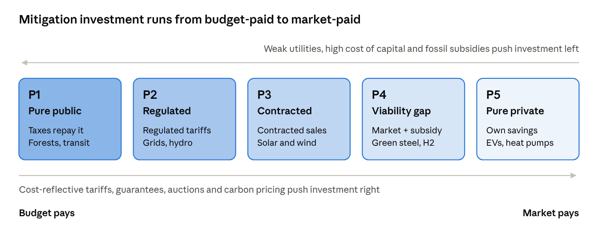
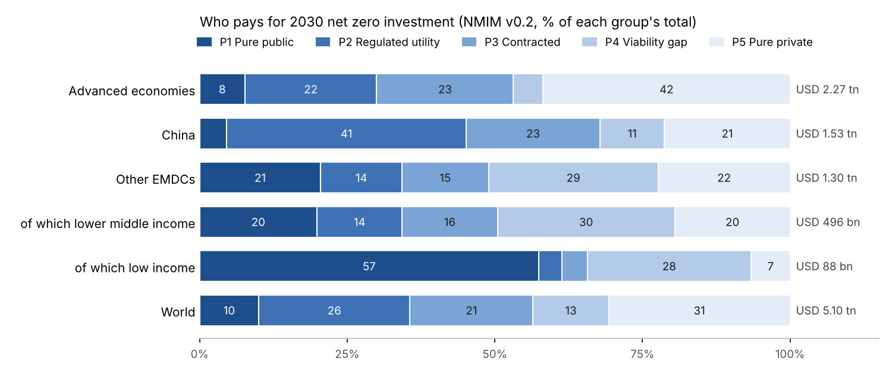
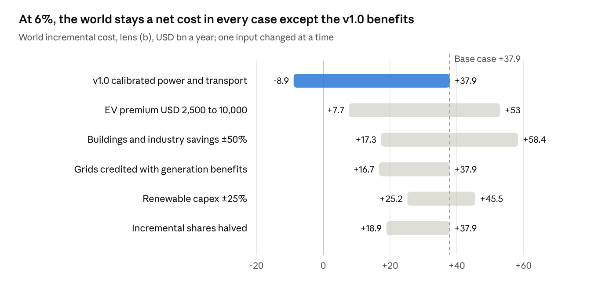
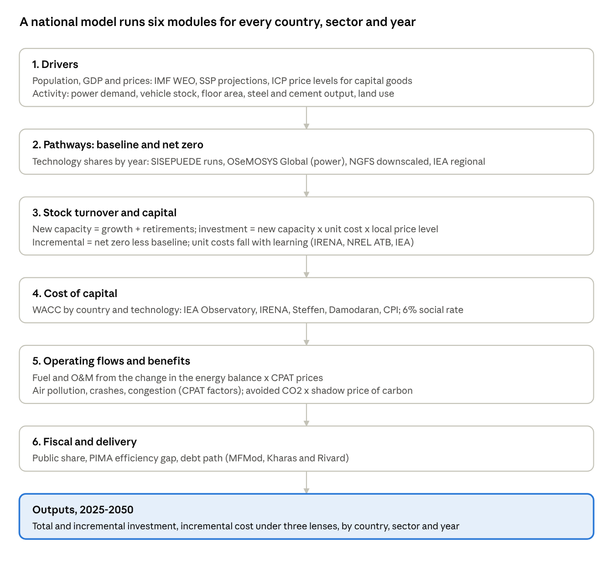

# Mitigation Investment Needs Model: Methodology

20 October 2026 · Stephen

Mitigation on a net zero path needs USD 5.2 tn of investment in 2030, of which USD 1.7 tn is incremental. At the World Bank's 6% that increment costs the world a net USD 38 bn a year, about USD 41 per tonne abated; counting local co-benefits it saves USD 43 bn.

## Summary

The model covers 195 economies and seven sectors, and gives each country's total and incremental investment and its incremental cost under three lenses. Version 1.1 replaces the weakest part of v1.0: a single savings ratio, calibrated on one region, that made every lens look like a large net saving.

| USD bn a year, 2030 | Advanced economies | China | Other EMDCs | World |
| --- | --- | --- | --- | --- |
| Total investment | 2,386 | 863 | 1,950 | 5,199 |
| Incremental investment | 907 | 328 | 468 | 1,703 |
| Incremental cost (a) market | +9 | +4 | +26 | +40 |
| (a) market, high case | +19 | +9 | +44 | +73 |
| (b) World Bank 6% | +15 | +9 | +13 | +38 |
| (c) 6% + local co-benefits | -2 | -27 | -13 | -43 |

Positive is a net cost. Other EMDCs face the largest market-rate penalty: their net cost doubles from 13 to 26 bn between 6% and market rates, and reaches 44 bn in the high case.

What changed in v1.1:

- **Power and transport** savings, co-benefits and abatement now come from each country's fuel mix (Ember), fuel prices and air-pollution costs (IMF CPAT), heat rates and IPCC CO2 factors.
- **Grids** get no savings of their own; **low-emission fuels** and **AFOLU** are costed per tonne abated.
- **A sensitivity sheet** runs 15 one-at-a-time tests; the 6% result stays a net cost in all but one.
- **Abatement** rises from 596 to 921 Mt a year per year of investment, because power displaces more carbon per dollar than the note's average.

Who pays (national model, NMIM v0.2): of 2030 net zero investment, 10% is pure public, 26% regulated utility, 21% contracted revenue, 13% viability gap and 31% pure private. In other EMDCs half needs public money beyond a guarantee, and their direct budget need is USD 379 bn in 2030 (see *Who pays*).

## Scope and definitions

The model covers mitigation only: the investment a country needs in 2030 to be on a net zero path, in USD billion a year at 2023 prices. Adaptation, loss and damage and the just transition are outside it.

| Term | Definition |
| --- | --- |
| Total investment (I) | All new capital in the seven mitigation sectors in 2030, including what would be built anyway. Comparable with IHLEG, IEA and Beyond the Gap. |
| Incremental investment (dI) | I less the investment a current-policies baseline would make in the same sectors. Comparable with the CCDRs and SISEPUEDE. |
| Capital charge | dI converted to an annual cost with the capital recovery factor at the lens rate over the asset life. |
| Savings | Fuel and operating costs avoided each year by the incremental assets, net of their own extra operating costs. |
| Local co-benefits | Avoided local damages each year, mainly air-pollution health costs. Public: no investor collects them. |
| Incremental cost | Capital charge less savings (less co-benefits in lens c). Positive is a net cost; negative a net saving. All flows are annual, over the asset life of one year's 2030 investment. |

The three lenses differ only in the rate and in what counts as a benefit:

| Lens | Rate | Benefits counted | Question it answers |
| --- | --- | --- | --- |
| (a) Market | Country WACC; high case adds the gap to 7% / 8% / 15% | Savings | What does an investor or household see? |
| (b) World Bank | 6% social discount rate (Fay et al. 2016); IBRD ~5.2% by switch | Savings | Does it pay at the cost of public money? |
| (c) World Bank + local co-benefits | 6% | Savings + local co-benefits; memo line adds carbon at USD 50-100/t | What does society get? |

Countries are grouped as in IHLEG (2024): the 41 IMF advanced economies, China, and all other emerging market and developing countries (EMDCs). Market rates are nominal and the 6% rate is real, as in the method note; a switch puts both in real terms.

## Core method

The model is the Tier 3 version of the SISEPUEDE-based method: published group totals are shared out to countries by physical drivers, then each country's incremental capital is costed at three rates against country-specific savings and co-benefits. Equation numbers follow the method note.

**1. Group pools.** For each group g (advanced economies, China, other EMDCs) and sector s, the 2030 total is a published clean-energy or nature total times a sector share:

```latex
P_{g,s} = CE_g \times \sigma_s \qquad (\text{AFOLU: } P_{g,\mathrm{AFOLU}} = N_g)
```

CE is USD 4.8 tn world, 1.6 tn EMDCs (IHLEG 2024), 0.85 tn China (IEA-IFC 2023), advanced economies the residual. The sector shares are IEA-IFC's for EMDEs in the early 2030s.

**2. Allocation to countries (equations 1 and 3).** Each country's share of its group pool is a weight w built from a physical driver D, PPP GDP and the price level p:

```latex
w_{c,s} = \left[\beta \frac{D_{c,s}}{\sum_{g} D_{s}} + (1-\beta)\frac{GDP^{PPP}_c}{\sum_{g} GDP^{PPP}}\right] p_c^{\varphi}, \qquad I_{c,s} = P_{g,s}\frac{w_{c,s}}{\sum_{g} w_{s}}
```

β = 0.5 weights today's physical activity (what must be replaced) against economic size (what will grow). φ = 0.5 passes half of the local price level into capital costs, since much clean-energy equipment is traded. Group totals are reproduced exactly.

**3. Incremental investment (equation 2).** dI = I × incremental share: 0.38 for advanced economies and China (McKinsey 2022: USD 3.5 tn over today on 9.2 tn gross), 0.24 for EMDCs (CCDR USD 574 bn against IHLEG USD 2.4 tn). Shares can be set by sector.

**4. Capital charge (equation 4).** Each dollar of dI costs a fixed amount a year over its life n:

```latex
A = dI \times CRF(r,n), \qquad CRF(r,n) = \frac{r}{1-(1+r)^{-n}}
```

**5. Incremental cost (equations 6 and 7).** With b = savings, c = local co-benefits per dollar of capital a year:

```latex
IC_{(a)} = dI\,[CRF(r^{mkt}_c,n) - b], \quad IC_{(b)} = dI\,[CRF(6\%,n) - b], \quad IC_{(c)} = IC_{(b)} - c\,dI
```

Abatement is a × dI (tCO2e a year per USD 1,000), so cost per tonne = IC / abatement. A memo line subtracts abatement valued at the World Bank shadow price of carbon (USD 50-100/t in 2030).

All flows are for one year's 2030 investment, spread over its asset life, as in the method note's Tables 6 and 7. Results are reported by country, by group and by sector.

## Cost of capital

Lens (a) uses one market WACC per country, chosen down a three-step hierarchy; 84 of 195 economies have an observed value, and the rest fall to the IHLEG group rate until Damodaran data are loaded.

| Step | Source | Coverage | How it is used |
| --- | --- | --- | --- |
| 1. Observed | IRENA (2022) real after-tax solar WACC, ref. year 2021, converted to nominal at 2% inflation; Steffen et al. (2025) nominal after-tax WACC, latest financing year | 84 economies (dashboard Finance 1 block) | Average of the available observations |
| 2. Damodaran build (equation 5) | Damodaran rating-based default spread, country risk premium and corporate tax | ~170 economies once loaded | WACC = D/V (rf + default spread)(1 - tax) + E/V (rf + ERP + CRP); then shifted by the mean gap to observed WACC where both exist |
| 3. Group default | IEA via IHLEG (2024) | All | AE 5.5%, China 6%, EMDC 10.5% |

The Damodaran build uses D/V = 0.70 (median leverage in the Steffen et al. database), a US 10-year rate of 4.2% (placeholder) and a mature-market ERP of 4.2% (Damodaran, July 2026). The calibration shift keeps the structural estimate on the level of observed renewable WACC, so it adds coverage without changing the average.

The high case adds each group's gap between the central and high rates (AE +1.5 points, China +2, EMDC +4.5) to the country rate. A technology premium per sector can be added in lens (a); it defaults to zero, as in the method note.

Lenses (b) and (c) use 6% everywhere: the World Bank social discount rate under the Ramsey rule (Fay et al. 2016). A switch replaces it with the IBRD lending rate, about 5.2% (Kharas and Rivard 2022).

Two cautions. Market WACC is nominal and 6% is real; the switch p_basis = 1 deflates market rates, which narrows the gap between (a) and (b) by about 2 points. And observed WACC is mostly for 2020-2021, when rates were low: China's 3.9% and Germany's 2.3% sit below 6%, so lens (a) is cheaper than lens (b) there.

## Savings, co-benefits and abatement

Version 1.1 replaces the single savings ratio for half the investment with physics: power and transport now derive b, c and a from each country's fuel mix, prices and pollution costs, and grids, fuels and AFOLU no longer get savings they do not produce. This was the weakest part of v1.0, where one ratio (b = 0.133, calibrated on SISEPUEDE's Latin American results) set the sign of every result.

Each sector uses one of four methods:

| Method | Sectors | b (savings per $ a year) | c (co-benefits per $ a year) | a (tCO2e a year per $1,000) |
| --- | --- | --- | --- | --- |
| Engineering | Power generation, transport | Fossil fuel bill avoided, at CPAT 2024 supply costs, less extra O&M or electricity | Air-pollution cost avoided, CPAT per GJ or litre | Fossil fuel avoided × IPCC 2006 CO2 factors |
| Enabling | Grids and storage | 0 (switch credits a share of generation benefits) | 0 | 0 |
| Calibrated | Buildings, industry | 0.133 × country fuel-cost index | 0.129 × country air-pollution index | 0.35 (method note) |
| Cost per tonne | Low-emission fuels, AFOLU | 0 | 0 for fuels; 0.129 for AFOLU (ecosystems) | 1000 × CRF(6%) / cost per tonne: USD 100/t fuels, USD 50/t AFOLU |

The country indices in the calibrated method are the CPAT fossil fuel bill per tonne of CO2 and the local air-pollution cost per tonne, each divided by its investment-weighted world average, capped at 0.25-4. They move b and c with fuel prices and pollution exposure while keeping the world average at the calibrated value.

Resulting world averages, per dollar of incremental investment:

| Sector | b | c | a | Capital charge at 6% |
| --- | --- | --- | --- | --- |
| Power generation | 0.055 | 0.041 | 0.86 | 0.078 |
| Grids and storage | 0 | 0 | 0 | 0.066 |
| Transport | 0.129 | 0.023 | 0.33 | 0.119 |
| Buildings | 0.137 | 0.134 | 0.35 | 0.078 |
| Industry | 0.135 | 0.133 | 0.35 | 0.078 |
| Low-emission fuels | 0 | 0 | 0.87 | 0.087 |
| AFOLU | 0 | 0.129 | 1.45 | 0.073 |

A sector pays for itself financially where b exceeds the capital charge. That now holds only for buildings and industry (still calibrated, and the next to replace) and, narrowly, transport. Power saves less fuel than v1.0 assumed because 2024 coal and US gas were cheap, but it abates 0.86 t per $1,000, more than twice the note's average. Local co-benefits are what turn power and AFOLU positive for society.

## Sector by sector

Power and grids are 54% of the USD 5.2 tn total and carry most of the net cost; buildings and industry are where the model is still least physical.

| Sector | Total I (USD bn) | Incremental dI | Incr. cost (b) | Incr. cost (c) | USD per tCO2e at (b) | Asset life |
| --- | --- | --- | --- | --- | --- | --- |
| Power generation | 1,680 | 560 | +13 | -10 | 27 | 25 |
| Grids and storage | 1,152 | 384 | +26 | +26 | n.a. | 40 |
| Transport | 713 | 238 | -2 | -8 | -30 | 12 |
| Buildings | 554 | 185 | -11 | -36 | -167 | 25 |
| Industry | 317 | 106 | -6 | -20 | -162 | 25 |
| Low-emission fuels | 384 | 128 | +11 | +11 | 100 | 20 |
| AFOLU and nature | 399 | 103 | +7 | -6 | 50 | 30 |
| **Total** | **5,199** | **1,703** | **+38** | **-43** | **41** | |

USD bn a year for one year's 2030 investment, world, v1.1 defaults.

### Power generation

- **What it covers:** solar, wind and other low-emission generation; 35% of clean energy (IEA-IFC 2023).
- **Allocation driver:** electricity demand, TWh (CPAT 2024).
- **Savings:** each USD 1,000 buys 2,301 kWh a year (50/50 solar at USD 760/kW and 17%, wind at USD 1,160/kW and 35%). That displaces fossil power in proportion to its share of generation (Ember), at the country's coal/gas/oil mix, heat rates of 10 / 7.5 / 10.5 GJ/MWh, and CPAT 2024 supply costs. Renewable O&M of 1.5% of capital is netted off.
- **Example:** India, 73% fossil and 97% of it coal, saves USD 32 a year per USD 1,000 but abates 1.57 t, so it costs about USD 29/t at 6% and breaks even with air-pollution co-benefits.
- **Weak points:** no credit for fossil plants not built in growing systems (makes it conservative); 2024 fuel prices; average rather than marginal displacement.

### Grids and storage

- **What it covers:** transmission, distribution, storage; 24% of clean energy.
- **Driver:** electricity demand. **Life:** 40 years.
- **Benefits:** none of its own, because grids enable generation savings rather than producing them. A switch credits grids with generation's per-dollar benefits; at 1 the world result moves from +38 to +17 at (b).
- **Weak point:** this is the largest single net cost and depends entirely on how system benefits are split.

### Transport

- **What it covers:** EVs and charging, plus transit (the pool is 45% of end-use investment, an assumption).
- **Driver:** road fuel energy (gasoline and diesel, CPAT).
- **Savings:** per vehicle, 15,000 km a year at 7.5 l/100 km of gasoline replaced by 0.18 kWh/km of power, plus USD 0.012/km maintenance; divided by a USD 5,000 purchase premium in 2030. Abatement nets off the grid's CO2.
- **Example:** India saves USD 639 a vehicle a year (b = 0.128) and abates 0.17 t per USD 1,000, low because its grid is coal-heavy.
- **Weak points:** the premium (an assumption; SISEPUEDE used USD 13,000 for 2019, IEA reports near parity in China); transit and rail are costed as if they were EVs; no congestion or crash benefits are counted.

### Buildings and industry

- **What they cover:** efficiency, heat pumps, electrification of heat; CCS in industry. 35% and 20% of end use (assumptions).
- **Drivers:** building and industrial energy use, EJ (CPAT).
- **Benefits:** still calibrated: b = 0.133 and c = 0.129 (SISEPUEDE LAC), moved by the country fuel-cost and air-pollution indices; a = 0.35.
- **Weak point:** these two are now the only sectors where savings rest on one region's calibration, and they produce most of the net saving. They are the first to move to engineering parameters (heat-pump and efficiency cost curves).

### Low-emission fuels and fuel supply

- **What it covers:** hydrogen, biofuels, CCS on fuel supply, methane abatement; 8% of clean energy.
- **Driver:** fossil energy supply, EJ.
- **Benefits:** no fuel savings (these fuels cost more than what they replace). Abatement is set by a levelised cost of USD 100/t, the IPCC AR6 threshold under which options could halve 2019 emissions by 2030.
- **Weak point:** methane abatement is much cheaper (often negative); it should be split out.

### AFOLU and nature

- **What it covers:** forests, ecosystems, agriculture. EMDCs USD 350 bn (IHLEG); advanced economies and China USD 49 bn (UNEP tripling of nature-based solutions, split by assumption).
- **Driver:** non-CO2 emissions plus net land-use emissions (CPAT).
- **Benefits:** no fuel savings; ecosystem co-benefits at c = 0.129; abatement at USD 50/t (IPCC AR6: 8-14 Gt a year below USD 100/t, 30-50% of it below USD 20/t).
- **Weak point:** the spending is partly current, not capital; the 30-year annuity is a convention.

## PIMA and delivery capacity

Weak public investment management raises the money needed for the same physical assets: the PIMA adjustment lifts world total investment from USD 5.2 tn to 5.8 tn, and EMDC investment by 16%.

The adjustment applies only to the public share of investment, scaled up by the share of value lost to inefficiency:

```latex
I^{PIMA}_c = I_c\left[(1-\pi_g) + \frac{\pi_g}{1-gap_c}\right]
```

| Input | Value | Source |
| --- | --- | --- |
| Efficiency gap by income | AE 13%, EM 27%, LIC 40% | IMF (2015), Making Public Investment More Efficient |
| Country gap from PEFA PI-11 (79 economies) | Score 1 → 40%, score 4 → 13%, linear | Author's mapping onto the IMF gaps |
| Public share of investment | AE 30%, China 50%, EMDC 40% | EMDC: IEA-IFC (2023), about 60% private; AE and China assumptions |
| Reform scenario | Closes two-thirds of the gap | IMF (2015) |

The dashboard's other PIMA indicators are reported beside each country but do not enter the formula: capital budget execution (BOOST, 104 economies), PEFA PI-12.2 asset monitoring, and whether a climate-PFM diagnostic is on record (UNDP 2022). IMF PIMA and C-PIMA scores themselves are not yet in the data; they would replace the PEFA mapping directly.

## Who pays: a typology of investment needs

Mitigation investment falls into five types, set by one question: where does the money to repay it come from? In 2030, NMIM v0.2 puts 10% of the world's USD 5.1 tn of net zero investment with the budget (P1) and 13% with private investors who need a public top-up (P4). In other EMDCs those two types are half of needs, and in low-income countries 85%.

### The five types

| Type | Where repayment comes from | Who typically finances it | Covers its own cost? | Main instruments | Examples |
| --- | --- | --- | --- | --- | --- |
| **P1 Pure public** | Taxes; no user revenue | Budget, concessional loans, grants | No | Budget capital spending, MDB sovereign loans, climate funds | Forest protection, transit rights of way, public building retrofits, R&D, grid extension for access |
| **P2 Regulated utility** (quasi-public) | Tariffs set by a regulator on a regulated asset base | State or private utilities, sovereign-guaranteed debt | Yes, if tariffs recover costs | Rate-of-return regulation, utility bonds, MDB utility loans | Transmission, distribution, utility-built hydro and nuclear, grid storage |
| **P3 Contracted revenue** (quasi-private) | A long-term contract with a public or regulated buyer | Independent producers, project finance | Yes, if the buyer is creditworthy | PPAs, contracts for difference, auctions, guarantees | Utility solar and wind, storage with capacity payments, charging concessions |
| **P4 Viability gap** (private with subsidy) | Market revenue plus a public top-up that closes a cost gap | Firms, with public co-funding | Not yet | Carbon contracts for difference, capital grants, carbon pricing, green procurement | Green steel and cement, CCS, hydrogen, sustainable aviation fuel |
| **P5 Pure private** | Savings or sales to the investor's own customers | Households, firms, banks | Yes, from fuel and energy savings | Consumer and green loans, standards, feebates | EVs, rooftop solar, heat pumps, industrial efficiency |

P2 and P3 are the quasi-private middle: they pay for themselves, but only through a public decision on tariffs or a public counterparty. Generation with revenues sits here in most countries. P4 is private investment that does not yet cover its cost; the public share is the gap, not the whole project.



*Investment typology · five types on one spectrum*

### Sector by sector

The same asset can sit in different types depending on the country. The table gives the typical type in each country group.

| Investment | Model sector | Advanced | Middle income | Low income | What decides the type |
| --- | --- | --- | --- | --- | --- |
| Utility solar and wind | Generation | P3 (some merchant P5) | P3 | P3 if the buyer is creditworthy, else P2 | Offtaker credit; auctions and guarantees |
| Hydro, nuclear, geothermal | Generation | P2 | P2 | P2 or P1 | Scale, long lead times, state ownership |
| Rooftop and distributed solar | Generation | P5 | P5 | P5 | Net metering or self-use savings |
| Mini-grids and off-grid solar | Generation | n.a. | P4 | P4 | Results-based subsidy for poor customers |
| Transmission and distribution | Grids | P2 | P2 | P1 or P2 | Cost-reflective tariffs; collection and losses |
| Grid-scale storage | Grids | P3 | P3 or P2 | P2 | Capacity payments or regulated asset |
| Grid extension for access | Grids | n.a. | P1 | P1 | No paying customers at the start |
| EVs (cars, two- and three-wheelers) | Transport | P5 | P5 or P4 | P4 | Upfront premium vs fuel savings; feebates |
| Electric buses, charging | Transport | P3 or P5 | P3 | P1 or P3 | Municipal concessions, fleet leasing, utilisation risk |
| Rail, metro, bus rapid transit | Transport | P1 | P1 | P1 | Fares rarely recover capital |
| Heat pumps and efficiency | Buildings | P5 | P4 | P4 | Savings vs upfront cost; credit access |
| Public building retrofits | Buildings | P1 | P1 | P1 | The owner is the state |
| Industrial efficiency and electrification | Industry | P5 | P5 | P5 or P4 | Short paybacks, finance access |
| Green steel, cement, ammonia, CCS | Industry | P4 | P4 | P4 | No market premium yet; carbon price and CBAM |
| Methane abatement in oil and gas | Fuels | P5 | P5 | P5 | Captured gas is sold |
| Hydrogen and biofuels | Fuels | P4 | P4 | P4 | Cost gap to fossil fuels |
| Forest protection and restoration | AFOLU | P1 | P1 or P4 | P1 or P4 | Public land; results-based payments, carbon credits |
| Climate-smart agriculture | AFOLU | P4 or P5 | P4 | P4 | Yield gains vs upfront cost |
| Planning, MRV, R&D | Cross-cutting | P1 | P1 | P1 | Pure public good |

### Power market structure

Power and grids are almost half of net zero investment, and their type depends most on how the sector is organised. NMIM v0.2 gives every country a market structure code from the dashboard's power sector indicators:

| Code | Structure | Who builds generation | Countries |
| --- | --- | --- | --- |
| 1 | Vertically integrated utility, no IPPs | The utility, on its regulated balance sheet (P2), or the budget (P1) | 38 |
| 2 | Single buyer with IPPs | IPPs under PPAs with the utility (P3), plus utility plants (P2) | 86 |
| 3 | Wholesale competition | Contracted (CfDs, auctions, corporate PPAs: P3) and merchant (P5) | 62 |

- **Source:** the Power Sector Reform Tracker (Urpelainen and Yang; 142 non-OECD countries to 2013): 3 if a wholesale market, 2 if IPPs, else 1, as on the dashboard.
- **Curated:** the 48 countries PSRT does not cover (OECD and small states), and 12 where it is out of date or codes a market law that never opened a market. For example, Viet Nam is 3 (wholesale market since 2019); Egypt, Pakistan, Nigeria and Ghana are 2 (single buyers).
- **Updated with PPI:** where PSRT gives 1 but the World Bank PPI database records two or more private generation projects reaching close in 2014-2024, the code is 2 (16 countries).
- **Also recorded per country** (workbook PowerMarket sheet): independent regulator, unbundling, privatisation, cost-reflective tariffs (PSRT); PPI private electricity investment, its solar and wind and merchant shares, private distribution and transmission; electricity cost recovery and explicit electricity subsidies (CPAT); RISE renewable energy and level playing field scores.

### How the model assigns types

The power market structure sets the starting split of generation; grids are P2 except a private contracted share of 0, 5 and 15% by structure.

| Power generation | Utility (P2) | Contracted (P3) | Merchant and distributed (P5) |
| --- | --- | --- | --- |
| 1 Vertically integrated | 70% | 25% | 5% |
| 2 Single buyer | 35% | 55% | 10% |
| 3 Wholesale market | 10% | 55% | 35% |

Three country indices, each from 0 to 1, then move investment toward the budget:

```
u = MIN(1, MAX(0, (1 - cost recovery) / 0.5))     utility: retail price / supply cost (CPAT 2024)
h = MIN(1, MAX(0, (market WACC - 6%) / 8%))       cost of capital (v1.1 country WACC)
v = MIN(1, MAX(0, explicit fossil subsidies / 2% of GDP))
m = MIN(1, 0.4h + 0.2v + credit constraint)       top-up share of market end-use investment
```

The credit constraint is 30% in low-income and 15% in lower-middle-income countries.

| Sector | Rule |
| --- | --- |
| Generation | P1 = P2₀ × 0.5u (utility plants tariffs do not repay); P4 = P3₀ × 0.4u (IPPs need guarantees from a weak buyer) + P5₀ × min(1, 0.4h) |
| Grids and storage | P1 = P2₀ × min(1, 0.6u + access), access 25% (LIC), 10% (LMIC) |
| Transport | P1 15/10/5/5% by income (public buses and fleets), P3 10% (charging concessions), the rest P4 = m, P5 = 1 − m |
| Buildings | P1 40/40/35/30% by income (public buildings, social housing), the rest P4 = m, P5 = 1 − m |
| Industry | CCS on CBAM goods is P4; fuel switch is P4 = 30% + 70% × m, the rest P5 |
| Non-CO2 | P1 30/25/20/20% by income, P5 = 35% × (1 − m) (methane captured and sold), the rest P4 |
| Land use | P1 80/70/60/50% by income, the rest P4 (results-based payments, carbon credits) |
| Other energy CO2 | P4 (aviation, shipping) |
| Unmodelled clean investment | Half on the generation split, half on the buildings split (IEA: about half of clean investment is power) |

The **direct budget need** is P1 plus the public gap in P4 (30% of its capital). **Private capital** is P3 + P5 + the other 70% of P4. Every share is a parameter on the workbook's Inputs sheet (`ty_*`, marked † as assumptions). The Typology sheet shows the selected country's indices, its share matrix and its investment by type each year. The engine and the workbook agree to 1e-9, and the five types sum to total investment in every country and year.

### Results



| 2030, USD bn | Advanced economies | China | Other EMDCs | World |
| --- | --- | --- | --- | --- |
| P1 Pure public | 174 | 70 | 267 | 511 |
| P2 Regulated utility | 508 | 620 | 179 | 1,307 |
| P3 Contracted revenue | 526 | 346 | 191 | 1,063 |
| P4 Viability gap | 114 | 167 | 374 | 655 |
| P5 Pure private | 951 | 325 | 291 | 1,567 |
| **Net zero investment** | **2,273** | **1,526** | **1,303** | **5,103** |
| Direct budget need (P1 + gap of P4) | 209 | 120 | 379 | 708 |
| of which incremental | 111 | 82 | 313 | 506 |
| Private capital, share | 69% | 52% | 57% | 61% |

- **China** is mostly P2 (41%) because its power and grids run through state utilities and grid companies buying from state generators.
- **Advanced economies** have the largest P5 share (42%): wholesale markets leave room for merchant and distributed power, and households and firms buy EVs, heat pumps and rooftop solar out of savings.
- **Other EMDCs** need public money beyond a guarantee for half their investment (P1 21%, P4 29%). Their budget need, USD 379 bn in 2030, is 29% of their needs, and 313 bn of it is incremental.
- **Low-income countries** are 57% P1: land use, grids for access and utilities that do not recover costs. Two-thirds of their USD 88 bn falls on the budget.
- **Market structure matters:** in wholesale markets 38% of investment is P5; under vertically integrated utilities, 20%, with a quarter P1.
- The 57% private share for other EMDCs is close to IEA-IFC's estimate that about 60% of EMDE clean energy investment must be private.

### How country context moves an investment

The direction is the same everywhere: the weaker the institutions and the higher the cost of capital, the further toward P1 an investment falls. A solar farm is P3 in Brazil, where the buyer is creditworthy and auctions are tested. In a country whose utility recovers only part of its costs it is effectively P2, and in a fragile state P1, because a public guarantee or the budget stands behind the contract.

| Condition | Moves investment toward | Indicator (dashboard and NMIM) |
| --- | --- | --- |
| Utility not creditworthy or tariffs below cost | P3 → P2 → P1 | Cost recovery (CPAT); market structure, regulator (PSRT) |
| High cost of capital | P5 and P3 → P4 | Country WACC; official-private rate spread (IDS) |
| Fossil subsidies or no carbon price | P5 → P4 | Explicit subsidies (IMF FFS); carbon pricing |
| Weak public investment management | Raises the cost of P1 and P2 | PEFA PI-11, capex execution (BOOST); PIMA gap |

Policy moves investment the other way. Cost-reflective tariffs move P1 grids to P2. Guarantees and auctions move P2 generation to P3. Carbon pricing, subsidy reform and CBAM credit move P4 industry toward P5. Each move shifts spending off the budget.

### Financing implications and the three lenses

Only P1 and the gap in P4 are budget spending; for P2 and P3 the public job is to make revenue bankable.

| Type | Public role | Fiscal cost | What lowers the cost of capital | Lens that matters |
| --- | --- | --- | --- | --- |
| P1 Pure public | Finance and build it | Full capital cost, on budget | Concessional and MDB sovereign loans; better PIM | (b) 6% or IBRD rate; (c) for the economic case |
| P2 Regulated utility | Set cost-reflective tariffs; recapitalise utilities | Contingent: guarantees, arrears, tariff shortfalls | Regulatory credibility, utility reform | Between (a) and (b): regulated return |
| P3 Contracted revenue | Run auctions; stand behind the buyer | Contingent: payment guarantees, FX risk | Guarantees, FX hedging, standard contracts | (a) market WACC, reduced by de-risking |
| P4 Viability gap | Pay the gap: CfDs, grants, carbon price | The gap only | Carbon contracts for difference, green procurement | (a) for the investor; (c) to justify the subsidy |
| P5 Pure private | Set standards and prices; ease credit | Little or none; subsidy reform raises revenue | Green credit lines, feebates | (a) market or household rate |

Lens (a) is what P3 to P5 investors see. Lens (b) is the cost of P1 and of utility debt raised on public terms; the gap between (a) and (b) is the value of de-risking for P3 and the case for concessional finance. Lens (c) is the case for spending public money on P1 and the P4 gap: the co-benefits are public, so the budget is the natural payer.

### Weak points

- The type shares are judgements applied to country data. They should be replaced, country by country, with observed public-private splits: CCDR investment plans, CPI's Global Landscape of Climate Finance, IEA World Energy Investment by source of finance.
- PSRT ends in 2013, and the curated codes need review by power sector staff. PPI misses most domestic private investment and covers no advanced economies.
- Cost recovery compares average retail prices with CPAT supply costs; it misses collection losses and arrears, which often matter more for a utility's credit.

## Sensitivity

At the World Bank rate the world result ranges from USD 8 bn to 58 bn a year of net cost across 14 one-at-a-time tests; only reverting to v1.0's calibrated benefits makes it a saving. The three inputs to firm up first are the EV premium, the savings in buildings and industry, and how grid benefits are counted.



*Source: Sensitivity sheet, Mitigation_Investment_Needs_v1.1.xlsx · 15 runs*

The other lenses respond to different inputs:

- **Lens (a), market:** an EMDC default WACC of 15% raises the world net cost from 40 to 44 bn; comparing in real rather than nominal terms cuts it to 15 bn. Damodaran data would mainly move the 111 economies now on the group default.
- **Lens (c), with co-benefits:** stays a net saving in every case (USD -16 bn to -166 bn). Halving co-benefits in buildings, industry and AFOLU is the closest call, at -16 bn.
- **Abatement cost of fuels and CCS** (USD 50-200/t) changes cost per tonne and the carbon memo line only, not incremental cost.

The full table, with EMDC results and cost per tonne, is on the workbook's Sensitivity sheet. The runs are static values written by `run_sensitivity.py` and should be re-run after any change to inputs.

## Validation and benchmarks

The workbook reproduces the method note's own Table 7 exactly, and its incremental investment sits inside the published country and CCDR ranges; the benefit side has no independent benchmark yet.

| Check | Model | Benchmark | Source |
| --- | --- | --- | --- |
| Method note Table 7, advanced economies: charge / net with co-benefits | 205 / 505 | 205 / 506 | Method note, recomputed with the workbook's equations |
| Same, China | 106 / 248 | 106 / 248 | As above |
| Same, EMDCs | 275 / 441 | 275 / 441 | As above |
| World total investment | USD 5,199 bn | 5,199 (pools) | Must tie exactly |
| EMDC incremental investment | 1.4% of GDP | 1.4% of GDP | CCDR synthesis (World Bank 2023), includes adaptation |
| Brazil incremental | 1.4% of GDP | 1.9% | SISEPUEDE LAC (Kalra et al. 2023) |
| Mexico incremental | 1.1% of GDP | ~1% | SISEPUEDE LAC |
| Dominican Republic incremental | 1.1% of GDP | 1.6% | SISEPUEDE LAC |
| World cost per tonne at 6% | USD 41/t | Most potential below USD 100/t, half below USD 20/t | IPCC AR6 WGIII SPM C.12.1 |

The model is low against SISEPUEDE for Brazil and the Dominican Republic. SISEPUEDE covers non-capital technical costs and all of AFOLU, which this model counts only as a share of a regional pool.

The IPCC comparison is the main cross-check on the benefit side. IPCC finds that "for a smaller part of the potential, deployment leads to net cost savings" (SPM C.12.1). v1.1 now agrees in direction: a net cost of USD 38 bn a year at 6% overall, with savings in buildings, industry and transport. v1.0's large net saving did not.

## Toward a national-level global model

A national model for every country is feasible, and the current workbook is its skeleton: what is missing is a physical pathway per country (module 2), which today is borrowed from group totals. Replacing the allocation with country stock-turnover modelling turns a Tier 3 estimate into a Tier 2 one for all ~190 countries, with Tier 1 (SISEPUEDE or CCDR runs) wherever those exist.



*National model architecture · 6 modules*

Module 4 should also feed back into module 2: a higher cost of capital shifts the least-cost mix away from capital-heavy renewables (Ameli et al. 2021 find 35% less green power in Africa). The workbook cannot show that; a national model with an optimiser for power can.

### Three tiers, by data available

| Tier | Where | Physical pathway from | Countries |
| --- | --- | --- | --- |
| 1 | Country model run exists | SISEPUEDE (18 LAC; Uganda, Morocco, Libya in progress), CCDR models | ~60 |
| 2 | Open data only | OSeMOSYS Global for power; stock-turnover for vehicles, buildings, industry; NGFS downscaled energy; FAO for land | ~130 |
| 3 | Fallback | Current allocation of IHLEG/IEA group totals | Any gap |

### Can it be done here?

Yes, in stages, with two conditions. I can write and run the whole pipeline (Python, Excel output, the same structure as the dashboard build), assemble open data, run the sensitivity and uncertainty analysis, and document it. What I cannot do from this environment is reach most data hosts: IMF, World Bank API, Damodaran, IEA and Zenodo were blocked when v1.0 was built, so the sources must be uploaded or the environment's network allowance widened. And country results need review by people who know the countries; I cannot validate a pathway against local plans on my own.

| Phase | Deliverable | Depends on |
| --- | --- | --- |
| 1. Data layer | Country panel: activity, stocks, prices, WACC (adds Damodaran, IEA Observatory, CPI), PIMA scores | Data files or network access |
| 2. Power | Capacity build-out per country from OSeMOSYS Global or a simple least-cost merit model, with country WACC inside | OSeMOSYS Global data |
| 3. End use | Vehicle, building and industry stock-turnover with technology costs and learning | IEA/ICCT stock data, NREL ATB, IRENA |
| 4. AFOLU | Abatement potential and cost by country (IPCC AR6 database, FAO, Roe et al.) | Open databases |
| 5. Integration | Annual 2025-2050 results, three lenses, Monte Carlo, Tier 1 overrides from SISEPUEDE and CCDRs | Phases 1-4 |

Phases 2 and 3 are where most of the gain is: they replace the two parameters the results are most sensitive to (power fuel displacement and end-use savings) with country stock and cost data.

### Built: a simplified national model (NMIM v0.2)

A first, simplified national model now exists for 186 countries, annual 2024-2050. It puts net zero investment in 2030 at USD 5.1 tn, against IHLEG's 5.2 tn, and baseline investment at USD 2.1 tn, against IEA's 2.0 tn for 2024. It follows CPAT norms: CPAT's 2024 data and codes, CPAT's activity equation with its income-group elasticities, and a CPAT-layout workbook in live formulas. CBAM-goods process emissions come from the CBAM Policy Tool, and market WACC from the v1.1 workbook.

| USD bn a year, 2030 | Advanced economies | China | Other EMDCs | World |
| --- | --- | --- | --- | --- |
| Investment, baseline | 1,028 | 705 | 351 | 2,084 |
| Investment, net zero | 2,273 | 1,526 | 1,303 | 5,103 |
| Incremental investment | 1,245 | 822 | 952 | 3,018 |
| Incremental cost (a) market WACC | 104 | 152 | 436 | 693 |
| Incremental cost (b) 6% | 145 | 207 | 339 | 690 |
| Incremental cost (c) 6% + co-benefits | 72 | -105 | 199 | 166 |

Incremental cost here is the annual cost of all incremental capital in service, so it builds up over time: USD 1.2 tn a year by 2040 at (a) and (b). With co-benefits, it is a net saving of USD 0.7 tn a year by 2040.

One equation specification drives both the Python engine and the workbook formulas, and a check confirms they agree to 1e-9 for eight countries. The main simplifications: no price response, power mix set by target dates rather than least cost, car-equivalent vehicles, and assumed costs for buildings and industry. Version 0.2 adds the typology of who pays, driven by each country's power market structure, cost recovery, WACC and subsidies (see *Who pays*); other results are unchanged from v0.1. Files are in `InvestmentNeeds/national_model/`; the method note is `NMIM_Method_v0_2.md` and the workbook `NMIM_v0.2.xlsx`.

## Data and assumptions needed

Most of what a national model needs is open; the binding gaps are country cost of capital by technology, end-use stock data outside the OECD, and agreed baseline pathways. Status shows what the v1.1 workbook already has.

| Area | Data needed per country | Best open source | In v1.1? | Assumptions that must still be set |
| --- | --- | --- | --- | --- |
| Macro | GDP, population, growth to 2050, capital-goods price level | IMF WEO, SSP database, World Bank ICP (GFCF PPP) | GDP and growth to 2026; GDP price level as proxy | Growth path after 2030; price-level pass-through |
| Power | Demand, capacity and generation by technology, plant age, fuel prices, resource quality | Ember, OSeMOSYS Global, Global Energy Monitor plant trackers, IRENA costs, Global Solar/Wind Atlas | Demand, fossil mix, fuel prices | Capacity factors by country, retirement ages, reserve margins, storage needs |
| Grids | Network length, losses, interconnection | IEA grids report, World Bank, national utilities | Not modelled | Grid USD per USD of renewables (IEA: 0.6-1); split of system benefits |
| Transport | Vehicle stock and sales by type, km driven, fuel economy, EV prices | IEA Global EV Outlook, ICCT, OICA, national registries | Fuel use and prices only | EV premium path, km driven, transit and rail capex |
| Buildings | Floor area, heating and cooling demand, appliance stock | IEA, IIASA, national censuses | Energy use only | Retrofit rates, heat-pump cost and performance |
| Industry | Output of steel, cement, chemicals, aluminium; plant vintages | worldsteel, USGS, GEM steel and cement trackers | Energy use only | Technology routes (DRI, CCS), retrofit timing |
| Fuels and methane | Oil, gas and coal supply; methane intensity | IEA Methane Tracker, Climate TRACE | Fossil supply only | Abatement cost curve; hydrogen demand |
| AFOLU | Land use, deforestation, livestock, abatement potential and cost | FAOSTAT, Global Forest Watch, IPCC AR6 database, Roe et al. | Emissions only | Cost per tonne by measure; permanence |
| Cost of capital | WACC by country and technology; debt and equity terms | IEA CoC Observatory, IRENA, Steffen et al., Damodaran, CPI | Observed for 84 economies; Damodaran sheet empty | Technology premia; how fast de-risking cuts WACC |
| Prices and externalities | Fuel supply costs, air-pollution and road costs per unit | IMF CPAT (FFS 2024 data) | Yes | Fuel price paths to 2050 |
| Delivery | PIMA and C-PIMA scores, PEFA, capex execution, public share | IMF PIMA reports, PEFA, BOOST | PEFA and BOOST; no PIMA scores | Efficiency gap mapping; public/private split by sector |
| Baselines | Current-policies pathway per country | NGFS current policies, IEA STEPS, CCDR baselines | Implicit (incremental shares) | Which baseline defines "incremental" |

Three assumptions matter more than any dataset and should be agreed before a national build: the baseline that defines incremental investment; whether fossil plants avoided in growing systems are credited as savings; and the path of technology costs, especially EV premiums and heat pumps.

## Limitations and review list

The results are good for orders of magnitude and for comparing lenses, not yet for a country's financing plan.

- [ ] Load Damodaran country risk data (111 economies on the group default rate)
- [ ] Add IMF PIMA and C-PIMA scores to replace the PEFA mapping
- [ ] Replace calibrated savings in buildings and industry with engineering parameters
- [ ] Decide how grid benefits are counted (currently none)
- [ ] Split methane abatement out of low-emission fuels
- [ ] Set the EV premium path from IEA Global EV Outlook data
- [ ] Review yellow assumptions: AE/China AFOLU pools, end-use split, China WACC, public shares
- [ ] Credit avoided fossil plants in growing power systems (power is conservative without it)
- [ ] Confirm IRENA 2023 unit costs against the primary report
- [ ] Replace typology shares with observed public-private splits (CCDRs, CPI, IEA WEI); review the curated power market codes

Other limits: one year (2030) rather than a path; average rather than marginal displacement in power; 2024 fuel prices, when US gas and coal were cheap; Ember's "other fossil" priced as oil; no macroeconomic feedback.

## Sources

- Method note: *Global Investment Needs for Climate Action: A Method Based on SISEPUEDE* (October 2026)
- [IHLEG 3 (Bhattacharya et al. 2024)](https://www.lse.ac.uk/granthaminstitute/wp-content/uploads/2024/11/Raising-ambition-and-accelerating-delivery-of-climate-finance_Third-IHLEG-report.pdf), clean energy and nature totals
- [IEA-IFC (2023), Scaling Up Private Finance for Clean Energy in EMDEs](https://www.iea.org/reports/scaling-up-private-finance-for-clean-energy-in-emerging-and-developing-economies/key-findings), sector shares and private share
- [IEA World Energy Investment 2024](https://www.iea.org/reports/world-energy-investment-2024/overview-and-key-findings), 2024 clean-energy investment by group (national model calibration)
- [Urpelainen and Yang (2019), Global patterns of power sector reform, 1982-2013](https://dataverse.harvard.edu/dataset.xhtml?persistentId=doi:10.7910/DVN/M7SY6X), Power Sector Reform Tracker (market structure)
- [World Bank Private Participation in Infrastructure database (2024)](https://ppi.worldbank.org/en/ppidata), private electricity projects
- [World Bank RISE (2023)](https://rise.esmap.org/), regulatory indicators for sustainable energy
- [IMF (2015), Making Public Investment More Efficient](https://infrastructuregovern.imf.org/content/dam/PIMA/Forum/IGEUR/Resources/Making%20Public%20Investment%20More%20Efficient%202015.pdf), efficiency gaps
- IPCC AR6 WGIII Summary for Policymakers, C.9.1 and C.12 (repository copy, `_research/ipcc_pdfs/spm.txt`)
- IPCC 2006 Guidelines Vol. 2, Table 2.2, CO2 factors (repository copy, `_research/refs/fuel_ef_table.txt`)
- IMF CPAT / Fossil Fuel Subsidies data 2024; IMF WEO; Ember yearly electricity data; IRENA (2022) and Steffen et al. (2025) WACC; World Bank BOOST and PEFA: all via `TaxMacroFiscalDashboard/build`
- [Damodaran July 2026 update, as reported by BVWire](https://www.bvresources.com/articles/bvwire/global-damodaran-revises-country-risk-framework-after-us-rating-downgrade), mature-market equity risk premium
- Workbooks: `InvestmentNeeds/Mitigation_Investment_Needs_v1.1.xlsx`; `InvestmentNeeds/national_model/NMIM_v0.1.xlsx`
